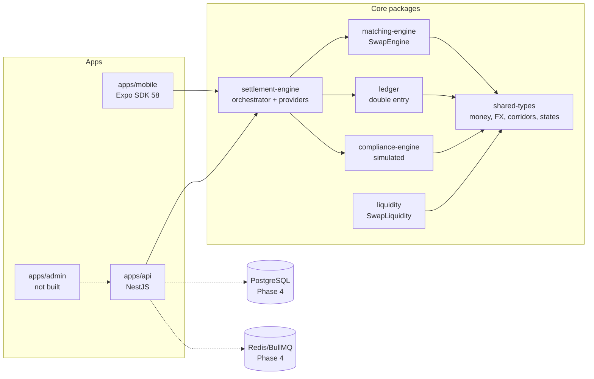
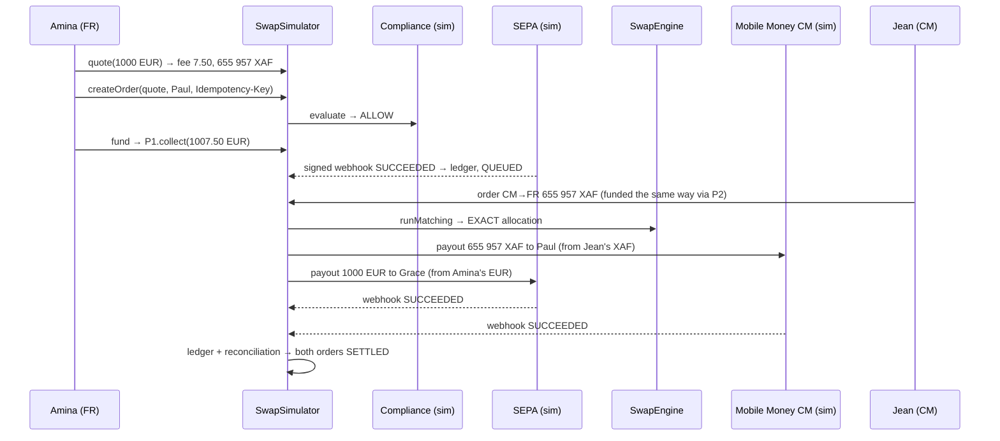
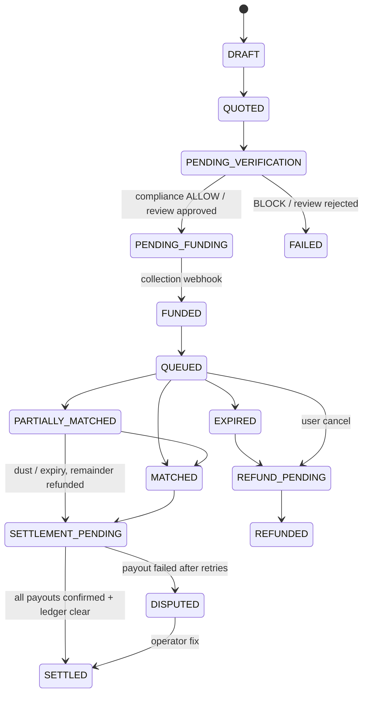

# Architecture

Modular monolith in an npm-workspaces monorepo. The financial core is a set of pure TypeScript packages; the mobile
app and the API are thin shells around them. No microservices.

Today the mobile app embeds the engines (offline demo) and the API keeps state in memory. Phase 4 moves persistence to
PostgreSQL (`apps/api/prisma/schema.prisma`) and the app to the API.

## End-to-end flow (France → Cameroon)

No euro crosses into Cameroon and no franc CFA crosses into France: each currency stays in its country.

## Ledger postings (simulated accounts)

| Event | Debit | Credit |
|---|---|---|
| Collection confirmed | `COLLECTION` (country) principal+fee | `CUSTOMER_FUNDS` (order) principal; `FEE_REVENUE` fee |
| Allocation | `CUSTOMER_FUNDS` (taker) | `BENEFICIARY_PAYABLE` (maker's beneficiary) — and symmetrically in the other currency |
| Payout confirmed | `BENEFICIARY_PAYABLE` | `COLLECTION` |
| Refund initiated | `CUSTOMER_FUNDS` remainder; `FEE_REVENUE` pro-rata fee | `REFUND_PAYABLE` |
| Refund confirmed | `REFUND_PAYABLE` | `COLLECTION` |

Each entry balances **per currency**; an allocation entry contains two independently balanced currency legs.
`reconcile()` checks the trial balance and that every successful provider operation has exactly the ledger effect
expected on the `COLLECTION` account of its country.

## Transfer state machine

The full table (including `CANCELLED`) is `TRANSITIONS` in `packages/shared-types/src/transfer.ts`.

## Persistence (PostgreSQL, Prisma 7)

Slice 1 persists the **ledger**. Rules live in two layers on purpose:

| Rule | Application (`PostgresLedger`) | Database (migration `ledger_integrity`) |
|---|---|---|
| Balanced per currency, ≥ 2 postings, no zero amounts | `validatePostings` (clear error) | deferred constraint triggers + CHECK, at COMMIT |
| Append-only | no update/delete methods | triggers refuse UPDATE / DELETE / TRUNCATE |
| History can't be extended | entry + postings in one transaction | postings only in the transaction that created the entry |
| Idempotency | look-up by key, compare postings | `idempotencyKey` UNIQUE (race: loser re-reads the winner) |
| One reversal per entry | checked before insert | `reversesId` UNIQUE + self-FK |

Production hardening still to do: run the app with a role that has only INSERT/SELECT on ledger tables (triggers can be
disabled by a table owner), and back the trigger check with periodic reconciliation.

## Concurrency and idempotency

| Risk | In this version | Phase 4 (Postgres) |
|---|---|---|
| Two matching runs at once | in-process lock (`MATCHING_IN_PROGRESS`) | single matching worker per corridor (BullMQ), `SELECT … FOR UPDATE SKIP LOCKED`, optimistic `version` column |
| Double order on retry | `Idempotency-Key` → same order | `@@unique([userId, idempotencyKey])` |
| Double payout | provider idempotency key `payoutId:attemptN`; new attempt only after a confirmed failure | `@@unique([providerId, kind, idempotencyKey])` |
| Webhook replay | event id de-duplication | `WebhookEvent` primary key |
| Double ledger posting | ledger idempotency key | `LedgerEntry.idempotencyKey @unique` |
